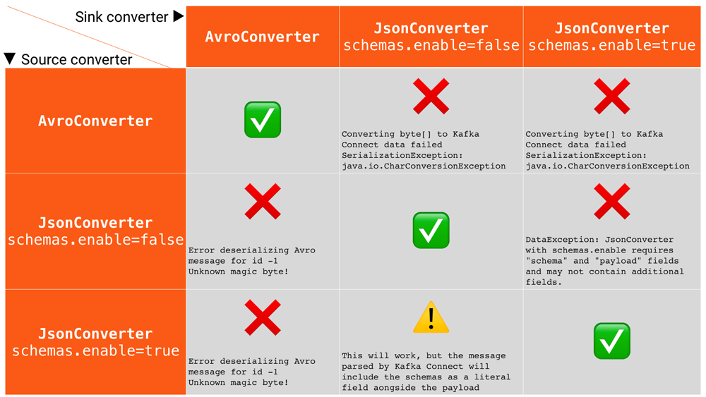

# Kafka Connect for Azure Cosmos DB (SQL API)

[](https://github.com/microsoft/kafka-connect-cosmosdb/blob/dev/CODE_OF_CONDUCT.MD) [](https://github.com/microsoft/kafka-connect-cosmosdb/blob/dev/CONTRIBUTING.md) [](https://github.com/microsoft/kafka-connect-cosmosdb/pulse)

[](https://github.com/microsoft/kafka-connect-cosmosdb/actions?query=workflow%3A%22Java+CI+with+Maven%22) [](https://github.com/microsoft/kafka-connect-cosmosdb/releases/)

## Introduction

File any issues / feature requests / questions etc. you may have in the [Issues](https://github.com/microsoft/kafka-connect-cosmosdb/issues) for this repo.

This project provides connectors for [Kafka Connect](http://kafka.apache.org/documentation.html#connect) to read from and write data to [Azure Cosmos DB](https://azure.microsoft.com/en-us/services/cosmos-db/)(SQL API).

The connectors in this repository are specifically for the Cosmos DB **SQL API**. 
If you are using Cosmos DB with other APIs then there is likely a specific connector for that API, but it's not this one. 
- Mongo API - [MongoDB Kafka Connector](https://www.mongodb.com/docs/kafka-connector/current/)
- Cassandra API - [Cassandra Sink Connector](https://docs.confluent.io/kafka-connect-cassandra/current/overview.html)
- Gremlin API - [Kafka Connect connector for Cosmos DB Gremlin API](https://github.com/Azure/kafka-connect-cosmosdb-graph)

## Exactly-Once Support

- **Source** Connector
  - For the time being, this connector supports at-least once with multiple tasks and exactly-once for single tasks.
- **Sink** Connector
  - The sink connector fully supports exactly-once semantics.

## Supported Data Formats

The sink & source connectors are configurable in order to support:

| Format Name  | Description |
| :----------- | :---------- |
| JSON (Plain) | JSON record structure without any attached schema. |
| JSON with Schema | JSON record structure with explicit schema information to ensure the data matches the expected format. |
| AVRO | A row-oriented remote procedure call and data serialization framework developed within Apache's Hadoop project. It uses JSON for defining data types and protocols, and serializes data in a compact binary format.

Since key and value settings, including the format and serialization, can be independently configured in Kafka, it is possible to work with different data formats for records' keys and values respectively.

To cater for this there is converter configuration for both *key.converter* and *value.converter*.

### Converter Configuration Examples

#### JSON (Plain)

- If you need to use JSON without Schema Registry for Connect data, you can use the JsonConverter supported with Kafka. The example below shows the JsonConverter key and value properties that are added to the configuration:

  ```properties
  key.converter=org.apache.kafka.connect.json.JsonConverter
  key.converter.schemas.enable=false
  value.converter=org.apache.kafka.connect.json.JsonConverter
  value.converter.schemas.enable=false
  ```

#### JSON with Schema

- When the properties `key.converter.schemas.enable` and `value.converter.schemas.enable` are set to true, the key or value is not treated as plain JSON, but rather as a composite JSON object containing both an internal schema and the data.

  ```properties
  key.converter=org.apache.kafka.connect.json.JsonConverter
  key.converter.schemas.enable=true
  value.converter=org.apache.kafka.connect.json.JsonConverter
  value.converter.schemas.enable=true
  ```

- The resulting message to Kafka would look like the example below, with schema and payload top-level elements in the JSON:

  ```json
  {
    "schema": {
      "type": "struct",
      "fields": [
        {
          "type": "int32",
          "optional": false,
          "field": "userid"
        },
        {
          "type": "string",
          "optional": false,
          "field": "name"
        }
      ],
      "optional": false,
      "name": "ksql.users"
    },
    "payload": {
      "userid": 123,
      "name": "user's name"
    }
  }
  ```

> NOTE: The message written is made up of the schema + payload. Notice the size of the message, as well as the proportion of it that is made up of the payload vs. the schema. This is repeated in every message you write to Kafka. In scenarios like this, you may want to use a serialisation format like JSON Schema or Avro, where the schema is stored separately and the message holds just the payload.

#### AVRO

- This connector supports AVRO. To use AVRO you need to configure a AvroConverter so that Kafka Connect knows how to work with AVRO data. This connector has been tested with the [AvroConverter](https://www.confluent.io/hub/confluentinc/kafka-connect-avro-converter) supplied by Confluent, under Apache 2.0 license, but another custom converter can be used in its place instead if you prefer.

- Kafka deals with keys and values independently, you need to specify the `key.converter` and `value.converter` properties as required in the worker configuration.

- An additional converter property must also be added, when using  AvroConverter, that provides the URL for the Schema Registry.

The example below shows the AvroConverter key and value properties that are added to the configuration:

  ```properties
  key.converter=io.confluent.connect.avro.AvroConverter
  key.converter.schema.registry.url=http://schema-registry:8081
  value.converter=io.confluent.connect.avro.AvroConverter
  value.converter.schema.registry.url=http://schema-registry:8081
  ```

### Choosing a conversion format

- If you're configuring a **Source connector** and
  - If you want Kafka Connect to include plain JSON in the message it writes to Kafka, you'd set [JSON (Plain)](#json-plain) configuration.
  - If you want Kafka Connect to include the schema in the message it writes to Kafka, you’d set [JSON with Schema](#json-with-schema) configuration.
  - If you want Kafka Connect to include AVRO format in the message it writes to Kafka, you'd set [AVRO](#avro) configuration.

- If you’re consuming JSON data from a Kafka topic in to a **Sink connector**, you need to understand how the JSON was serialised when it was written to the Kafka topic:
  - If it was with JSON serialiser, then you need to set Kafka Connect to use the JSON converter `(org.apache.kafka.connect.json.JsonConverter)`.
    - If the JSON data was written as a plain string, then you need to determine if the data includes a nested schema/payload. If it does,then you would set, [JSON with Schema](#json-with-schema) configuration.
    - However, if you’re consuming JSON data and it doesn’t have the schema/payload construct, then you must tell Kafka Connect **not** to look for a schema by setting `schemas.enable=false` as per [JSON (Plain)](#json-plain) configuration.
  - If it was with AVRO serialiser, then you need to set Kafka Connect to use the AVRO converter `(io.confluent.connect.avro.AvroConverter)` as per [AVRO](#avro) configuration.

#### Common Errors

Some of the [common errors](https://www.confluent.io/blog/kafka-connect-deep-dive-converters-serialization-explained/#common-errors) you can get if you misconfigure the converters in Kafka Connect. These will show up in the sinks you configure for Kafka Connect, as it’s this point at which you’ll be trying to deserialize the messages already stored in Kafka. Converter problems tend not to occur in sources because it’s in the source that the serialization is set.



## Configuration

### Common Configuration Properties

The Sink and Source connectors share the following common configuration properties

| Name | Type | Description | Required/Optional |
| :--- | :--- | :--- | :--- |
| connect.cosmos.connection.endpoint | uri | Cosmos endpoint URI string | Required |
| connect.cosmos.master.key | password | Cosmos primary key. Not used with managed identity authentication. | Required for `MasterKey` authentication only |
| connect.cosmos.auth.type | string | Authentication type: `MasterKey` (default) or `ManagedIdentity`. | Optional |
| connect.cosmos.managed.identity.client.id | string | Client ID of a user-assigned managed identity. Omit for a system-assigned identity. | Optional; only valid with `ManagedIdentity` |
| connect.cosmos.databasename | string | The name of the Cosmos database the sink writes to | Required |
| connect.cosmos.containers.topicmap | string | Mapping between Kafka Topics and Cosmos Containers, formatted using CSV as shown: `topic#container,topic2#container2` | Required |

For Sink connector specific configuration, please refer to the [Sink Connector Documentation](./doc/README_Sink.md)

For Source connector specific configuration, please refer to the [Source Connector Documentation](./doc/README_Source.md)

### Managed identity authentication

Both connectors support Microsoft Entra authentication using the managed identity of the Azure resource hosting Kafka Connect. Enable a system-assigned identity on that resource, or attach a user-assigned identity. The identity must be available to every worker running the connector or its tasks.

Set the following properties in the connector configuration and remove `connect.cosmos.master.key`:

```properties
connect.cosmos.connection.endpoint=https://<account>.documents.azure.com:443/
connect.cosmos.auth.type=ManagedIdentity
```

For a user-assigned identity, also set its **client ID** (not its principal/object ID):

```properties
connect.cosmos.managed.identity.client.id=<managed-identity-client-id>
```

The connector uses `ManagedIdentityCredential`, automatically renewing access tokens without storing account keys. It does not fall back to master keys, developer credentials, or Azure CLI credentials if authentication fails. Existing configurations continue to use `MasterKey` by default.

Assign [Cosmos DB for NoSQL data-plane RBAC permissions](https://learn.microsoft.com/azure/cosmos-db/nosql/how-to-connect-role-based-access-control) to the identity's **principal ID**. Azure subscription/resource roles such as Contributor do not grant data access.

- **Sink:** grant Cosmos DB Built-in Data Contributor, scoped to the target database or containers, including metadata access.
- **Source:** grant Cosmos DB Built-in Data Reader on monitored containers (including change-feed access), and Cosmos DB Built-in Data Contributor on lease containers. A database-scoped Data Contributor assignment is a simpler, broader alternative.

Pre-create the database and target containers using the Azure portal, Azure CLI, or infrastructure tooling. For the source, also pre-create one lease container named `<source-container>-leases` per monitored container, in the same database, with partition key `/id`. Cosmos DB data-plane token authentication does not support database or container creation. In managed identity mode, the sink checks that the database exists instead of creating it, and the source reports an error if a lease container is missing. Master-key provisioning behavior is unchanged.

For example, assign Data Contributor at database scope using Azure CLI:

```bash
az cosmosdb sql role assignment create \
  --resource-group <resource-group> \
  --account-name <account> \
  --principal-id <managed-identity-principal-id> \
  --role-definition-id 00000000-0000-0000-0000-000000000002 \
  --scope "/dbs/<database>"
```

Allow time for role assignments to propagate before starting the connector. Managed identity also requires network access to the identity endpoint and Cosmos DB; it does not bypass firewalls or private endpoint configuration.

## Project Setup

Please refer [Developer Walkthrough and Project Setup](./doc/Developer_Walkthrough.md) for initial setup instructions.

## Performance Testing

For more information on the performance tests run for the Sink and Source connectors, refer to the [Performance testing document](./doc/Performance_Testing.md).

Refer to the [Performance Environment Setup](./src/perf/README.md) for exact steps on deploying the performance test environment for the Connectors.

## Dead Letter Queue
We introduced the standard dead level queue from Kafka. For more info see: https://www.confluent.io/blog/kafka-connect-deep-dive-error-handling-dead-letter-queues

## Resources

- [Kafka Connect](http://kafka.apache.org/documentation.html#connect)
- [Kafka Connect Deep Dive – Converters and Serialization Explained](https://www.confluent.io/blog/kafka-connect-deep-dive-converters-serialization-explained/)
